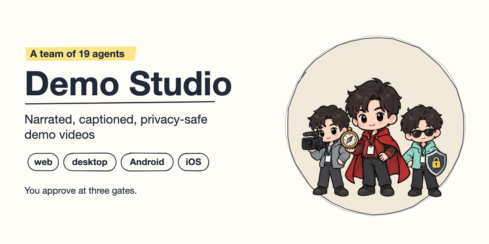
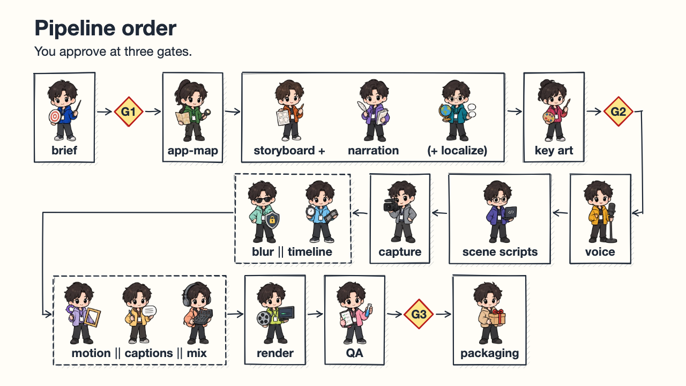
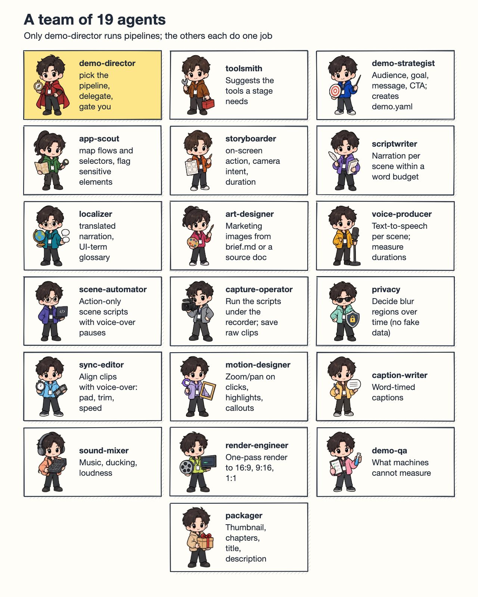

# Demo Studio



A [Claude Code](https://claude.com/claude-code) plugin: a team of 19 agents that plans, records, edits and packages narrated, captioned, privacy-safe demo videos for **web, desktop, Android and iOS** apps, and makes marketing images (SVG + PNG) from a doc such as this README.

You describe what to demo. The team writes the brief, storyboard and narration, records the app, blurs sensitive data, syncs the voice-over, adds motion and captions, mixes audio, renders 16:9 / 9:16 / 1:1 and checks the result. You approve at three gates.

This repo is a plugin marketplace (`demo-record-teams`) that ships one plugin: `plugins/demo-studio/` (v0.5.0).

## Install

```
/plugin marketplace add <path-to-this-repo or owner/repo>
/plugin install demo-studio@demo-record-teams
```

## Requirements

| Need | When |
|---|---|
| Python 3.10+ | always (toolkit and `project.py` are stdlib-only scripts) |
| ffmpeg | comes with the `capture` toolkit feature (bundled via imageio-ffmpeg); no system install needed |
| Node.js >= 18 | for the Remotion render engine (`remotion`, the default for every video; without Node the ffmpeg fallback renders basic motion), and macOS desktop capture (Appium Mac2) |
| macOS + Xcode + [AXe](https://github.com/cameroncooke/AXe) | only for iOS (`capture-ios`, Simulator only); on other systems it reports `blocked` |
| `adb` on PATH | only for Android |
| Remotion (via Node) | only for the PNG half of key art; without it `/demo-studio:art` produces SVG-only images |
| `ELEVENLABS_API_KEY` | only for the paid `voice-elevenlabs` option |

## Quick start

```
/demo-studio:new Show how a new user creates a project in Acme Tasks, for first-time admins, web
```

The director picks the steps and pauses at three gates:

| Gate | You approve | Before |
|---|---|---|
| **G1** | the brief (audience, goal, message, CTA) and `demo.yaml` (length, platform, formats, voice, motion level) | anything is planned |
| **G2** | storyboard + narration (+ the key art previews in `new`/`script`) | any recording |
| **G3** | the final renders and the QA verdict | packaging |
| **GA** | (only `/demo-studio:art`, no video) the marketing images and their QA verdict | anything is copied into your repo |



Pipeline order before recording: brief → app-map → storyboard + narration (+ localize) → key art (style question → art-designer → privacy audit → demo-qa) → G2 → voice → scene scripts. After recording: capture → (privacy ∥ sync-editor) → (motion-designer ∥ caption-writer ∥ sound-mixer) → render → QA. Captions and mix need the timeline, so they never run before sync-editor. Web recordings are 25 fps at the viewport size (a Playwright limit); the render upscales and keeps the source fps.

Already have a script? `/demo-studio:shoot`. Lost your place? `/demo-studio:run` with no argument resumes from `.demo/STATE.md`.

## Commands

All are `/demo-studio:<name>`.

| Command | Purpose |
|---|---|
| `run [request]` | Any demo-video request; the director picks the pipeline. Empty = resume. |
| `new <what, audience, platform>` | Make a video from scratch, brief to final render (G1, G2, G3). |
| `script <what to demo>` | Pre-production only: brief, storyboard, narration (G1, G2). |
| `shoot [slug]` | From an approved script to the rendered, QA-checked video (needs G2, ends at G3). |
| `rerecord <scenes and what changed>` | Re-shoot scenes after a UI change, then re-render. |
| `revoice <what to change>` | Change narration text, voice or language, then re-render. |
| `cut <ratio and/or length>` | Add an aspect-ratio variant (9:16, 1:1, 16:9) or a shorter cut. |
| `fix [symptom]` | Fix a problem in the finished video; empty = read QA report and render checks. |
| `review <video path or slug>` | Inspect an existing video without changing it. |
| `art <source doc>` | Marketing images (hero, pipeline, roster, social; SVG + PNG) from a doc such as `README.md`, privacy-audited and QA-checked; asks which visual style you want first (a list with recommendations R1-R3 and each keyword marked `[yes]` for exact or `[approx]` for approximated in SVG; reply R1-R3, 1-3 codes from different groups, a description or a reference link, or say skip; skipped if you name keywords or a style is already set, and you can change it at the gate); asks (GA) before placing them in `docs/images/` and the doc. No video. |
| `tools [features]` | Show or install the toolkit by feature; always asks first. |
| `status` | Show where the work stands (reads `STATE.md` only). |

## Agents

Only `demo-director` runs pipelines; the others each do one job and write only their own files.



| Agent | One job | Model |
|---|---|---|
| `demo-director` | Classify the request, pick the pipeline, delegate, gate you, keep the resume point | opus |
| `toolsmith` | Suggests the tools a stage needs (read-only); installs only what you approved | haiku |
| `demo-strategist` | Audience, goal, message, CTA; creates `demo.yaml` | inherit |
| `app-scout` | Explore the app, check platform, map flows and selectors, flag sensitive elements | inherit |
| `storyboarder` | Scenes and shots: on-screen action, camera intent, duration | opus |
| `scriptwriter` | Narration per scene within a word budget (`demo-storytelling` formula), in the source `language` | opus |
| `localizer` | When `language` differs from `voice.language`: translated narration, UI-term glossary, lexicon proposals, on-screen strings | inherit |
| `voice-producer` | Text-to-speech per scene; measure durations | haiku |
| `scene-automator` | Action-only scene scripts with voice-over pauses; dry-run | inherit |
| `capture-operator` | Run the scripts unmodified under the recorder; save raw clips | haiku |
| `privacy` | Decide blur regions over time (no fake data); audits key art for private data, never edits it | haiku |
| `sync-editor` | Align clips with voice-over: pad, trim, speed | inherit |
| `motion-designer` | Zoom/pan on clicks, highlights, callouts, title cards, device frames | inherit |
| `caption-writer` | Word-timed captions | haiku |
| `sound-mixer` | Music, ducking, loudness (default -14 LUFS, -1 dBTP; set in `demo.yaml`) | haiku |
| `render-engineer` | One-pass render to 16:9, 9:16, 1:1; measure the result | haiku |
| `demo-qa` | What machines cannot measure: spelling, broken UI, pacing, leaked personal data; PASS/FAIL (art mode checks the art set against Q1-Q10, including Q10, which compares each image with the chosen style) | inherit |
| `art-designer` | Marketing images from `brief.md` or a source doc (standalone `roster` is 1280x1600, taller than the rest): static SVG + PNG, text only from repo files; proposes where to place them | inherit |
| `packager` | Thumbnail, chapters, title, description, delivery manifest | haiku |

Voice-over is produced **before** scene scripts, so scene pauses fit the real audio durations.

## Skills

Loaded by agents as needed; you do not call them.

| Skill | Holds |
|---|---|
| `run-kits` | Roster, pipelines and gates, briefs, handoffs, workspace, `/fix` routing, toolkit approval, resume rules |
| `voice-over` | Voice engines and choice, pronunciation lexicon, natural speech rates, `[pause]`, recording your own voice |
| `demo-storytelling` | Story structure, hook, CTA, length and word budgets, scene-count rules |
| `platform-automation` | `mark()` contract, VO-pause and dry-run rules, per-platform references (web, desktop, mobile) |
| `motion-fx` | Motion levels none / basic / cinematic, effect recipes, safe areas, schema |
| `media-specs` | Encode specs, loudness, caption rules, render-check thresholds, key schemas |
| `key-art` | Visual rules for marketing images: composition, typography, color, formats, SVG craft, art check list (Q1-Q10), `references/characters.md` (every style shows the roles as chibi characters: your approved images, or vector ones drawn in the style), and `references/styles.md`: the style catalogue (97 keywords in groups A-G, 12 core recipes) behind the style question, and `assets/style-picker.html`, the template of the visual picker page |

## Workspace

Everything lives in `.demo/` in your project:

```
.demo/
  STATE.md  toolkit.json  .venv/
  <slug>/
    brief.md  demo.yaml  app-map.md  storyboard.md  narration.md  qa.md  qa-art.md
    art/  <id>.svg  <id>.png  readme-snippet.md  assets/ (your approved character images or sheet + crops)
    scenes.<platform>.*
    project.json  .demo.applied.json
    media/  sNN.raw.*  sNN.vo.wav  final-16x9.mp4  final-9x16.mp4
            final-1x1.mp4  final.vtt  thumb.png
```

Only two kinds of video file exist: raw clips and finals. Blur, motion, captions and mix are instructions in `project.json`, not intermediate videos.

### `demo.yaml`: the video's properties (you own it)

`brief.md` holds only prose (audience, goal, message, CTA, out of scope). Everything you can tune lives in `.demo/<slug>/demo.yaml`: `platform`, `length_s`, `formats`, `voice` (engine, name, language, lexicon), `motion.level`, `music` (style, duck_db), `captions` (burn_in, max_chars), `targets` (lufs, true_peak, max_drift_ms, caption_offset_ms), `privacy` (blur, real_data), `install`. The strategist creates it at G1 from `templates/demo.yaml` (every field commented with allowed values and its default); the director records your decisions in it; all other agents only read it.

Edit it any time. On `/demo-studio:run` (or `/demo-studio:fix`) the director validates it and diffs it against the last snapshot (taken after G1 and after every G3; no snapshot = first run), then re-runs only what your change affects (e.g. `voice.*` re-runs voice and everything after it; `music.*` re-runs the mix; `platform` re-records everything).

```
python scripts/config.py --slug <slug> init | validate | get <dotted.path> | diff [--json] | apply | apply-lexicon (--text T | --file F | stdin) [--json]
```
Stdlib only; a built-in strict parser accepts plain maps, lists and scalars (anything else is an error with the line number). Tests: `python -m unittest discover -s scripts/tests`.

### `project.json` key ownership

One owner per key; writes go through `scripts/project.py`, which locks the file and rejects the wrong writer (exit 4). Never edit it by hand.

| Key | Owner | Key | Owner |
|---|---|---|---|
| `events` | capture-operator | `captions` | caption-writer |
| `voice` | voice-producer | `mix` | sound-mixer |
| `blur` | privacy | `checks` | render-engineer |
| `timeline` | sync-editor | `delivery` | packager |
| `motion` | motion-designer | `art` | art-designer |
| `privacy` | privacy (art audit) | | |

Before the style question the director builds a visual picker page, `.demo/artifact_design/key_design_picker.html` (`scripts/style_picker.py`; rebuilt, never duplicated, on every ask): approximate previews of the recommended combos and the 12 core looks, plus every code by group. Click 1-3 codes (or a combo), copy the answer line and paste it into the chat. The page works offline and sends nothing.

`art` also carries the chosen `style` (1-3 catalogue codes, at most one per group, plus optional custom tweaks or a reference). art-designer writes it, but you choose it through demo-director. It is optional: a run without a style stays valid and is not re-run for it. `art` also lists `assets`: your own character images, used only after you approve them at the style question (privacy checks each one). Instead of images per role you can ask for a character sheet: the director shows you a prompt in the chat (no file), you run it yourself in ChatGPT or any image tool and send back ONE image with every character (transparent or solid `#FF00FF` background, characters apart). After you approve the image and the role order, `scripts/art_assets.py split` cuts one PNG per character (exit 0 ok, 1 split failed: count or background, 2 bad input). The plugin never drives the image tool for you.

```
python scripts/project.py --slug <slug> keys
python scripts/project.py deps voice     # what to re-run if voice changes
```

Dependency order: art → privacy, motion, delivery · voice → timeline, captions, mix · events → blur, timeline · timeline → motion, captions, mix · {blur, motion, captions, mix} → checks → delivery. A `length_s` change re-runs storyboarder (G2) → timeline → motion, captions, mix → checks → delivery; voice only if the narration changes. Pronunciation fixes live in `demo.yaml` `voice.lexicon` (written term → spoken spelling, applied to TTS input only; captions keep the written text); a lexicon change re-runs voice.

```
python scripts/project.py owner blur     # privacy
python scripts/project.py --slug <slug> check-blur   # blur covers every sensitive marker (exit 1 = gap)
```

## Toolkit

Nothing is installed up front. Right before a stage runs, the director checks what that stage needs; if something is missing, toolsmith suggests the options for **that stage only** and **you are asked first** with the size and effect (and a recommended default). Later stages are asked later. Declined features fall back (Remotion to the ffmpeg renderer with basic motion, word captions to sentence captions). Installs go into `.demo/` (`.venv`, `remotion/`, `appium/` for macOS desktop) and are recorded in `.demo/toolkit.json`. Your choice is saved in `demo.yaml` (`install.approved` / `install.declined`), so you are not asked twice.

Where several tools can do the same job you choose, and the recommended one is listed first: `scripts/setup_tools.py --options [voice|render]` shows the alternatives with size, requirements and status. The choice is stored in `demo.yaml` (`voice.engine`; the render engine as `remotion` in `install.approved` / `install.declined`).

```
python scripts/setup_tools.py --list | --options [job] | --stage [name] | --stages | --check [features] | --plan <features> | --install <features>
```

| Feature | What it gives | Size |
|---|---|---|
| `capture` | Web recording (Playwright Chromium) + bundled ffmpeg | ~250 MB |
| `capture-desktop` | Desktop window: pywinauto (Windows) / Appium Mac2 (macOS) | ~15 MB |
| `capture-android` | Android emulator/phone driven by `adb` (`mobile_driver.py`), recorded with scrcpy or adb | 0 MB (needs `adb`) |
| `capture-ios` | iOS Simulator driven by AXe + simctl (`mobile_driver.py`, macOS only; unverified) | 0 MB (needs Xcode, `axe`) |
| `voice-edge` | Microsoft Edge neural voices; online, free | ~5 MB |
| `voice-kokoro` | Kokoro TTS; fully offline, pulls PyTorch | ~2 GB |
| `voice-elevenlabs` | ElevenLabs voices; paid API | ~5 MB |
| `captions` | Word timing (faster-whisper), SRT/ASS | ~150 MB |
| `mix` | Music ducking, loudness normalisation | ~30 MB |
| `blur` | Moving-region blur for the ffmpeg fallback renderer (Remotion blurs by itself) | ~60 MB |
| `remotion` | Default render engine for every video: blur, motion (all levels), captions, audio in one pass | ~550 MB |
| `motion-basic` | Fallback renderer via ffmpeg filters (motion none/basic) | ~0 MB |
| `package` | Thumbnails, posters, covers | ~10 MB |

### Render engine (Remotion)

Every pipeline renders through one Remotion composition that ships with the plugin in `plugins/demo-studio/remotion/` (`render.mjs` + `src/`). The plugin never holds `node_modules`: `setup_tools.py --install remotion` copies that source into the project's `.demo/remotion/` (stamped with a source hash in `.sync.json`), then runs `npm install` and downloads headless Chrome there. After a plugin update, `--check remotion` reports the copy as out of date and `--install remotion` re-syncs it. The install ends with a render smoke test (one 64x64 PNG, 90 s limit). On every OS, if the downloaded Chrome hangs (seen once on macOS: every render timed out, while a plain copy of the same files rendered at once; the cause is not confirmed), the install copies Chrome to a per-user cache (macOS `~/Library/Caches`, Windows `%LOCALAPPDATA%`, Linux `$XDG_CACHE_HOME` or `~/.cache`, under `demo-studio/chrome-headless-shell/`; about 300 MB more), tests it again and records it as `browser_executable` in `.demo/toolkit.json`; `render.mjs` then uses it (env `DEMO_STUDIO_BROWSER` overrides). Any other failure stops the install with an OS hint (Linux: missing system libraries such as `libnss3`). `--check remotion --smoke` runs the test any time; plain `--check` does not launch Chrome. Agents only run it, never edit it:

```
node .demo/remotion/render.mjs --project .demo/<slug>/project.json --ratio 16x9 --out .demo/<slug>/media/final-16x9.mp4
     [--audio .demo/<slug>/media/render/mix.wav] [--burn-in] [--layout overlay|band] [--from-ms A --to-ms B | --still MS]
```

Key art (`/demo-studio:art`, and the `art` step of `new`/`script`) uses the same engine in raster mode to turn SVG layers into a PNG: `node .demo/remotion/render.mjs --art --size WxH --layer FILE --out FILE.png`. Your own character images (one per role, approved by you at the style question) are placed as PNG layers with `--layer FILE.png@X,Y,W,H`; the SVGs stay raster-free. Without Remotion the art stays SVG-only.

Remotion is free for individuals and companies of up to 3 people; larger companies need a [Remotion company license](https://www.remotion.dev/license). Without Node, or with `remotion` declined, the ffmpeg fallback renders motion none/basic.

## Fixing a finished video

`/demo-studio:fix "scene 3 out of sync"` (or no argument, to read `qa.md` and render checks). The director diagnoses, routes to the one owner, re-runs only the dependent steps, re-renders and re-checks.

| Symptom | Owner |
|---|---|
| Audio/video out of sync | sync-editor |
| Email, name or amount still visible | privacy |
| Different look or style of key art | director re-asks the style, then art-designer redoes all items, privacy and demo-qa (art) |
| Wrong key art, or private data in it | art-designer, then privacy and demo-qa (art) |
| Wrong click, UI changed, scene broken | scene-automator |
| Black frame, freeze, bad recording | capture-operator |
| Wrong translation, UI term, on-screen text language | localizer, then voice-producer |
| Awkward narration | scriptwriter, (localizer), then voice-producer |
| Caption wrong or off | caption-writer |
| Music too loud, voice too quiet | sound-mixer |
| Zoom in the wrong place, missing callout | motion-designer |
| You edited `demo.yaml` | director runs `config.py diff`, then the owners it lists |

Owner unclear: it asks you. Same defect after two attempts: it stops and reports. If you already know the cause, `/rerecord` and `/revoice` are shortcuts.

## Privacy

- Real data in the app is **blurred, not replaced**: `privacy` never fakes or swaps content.
- `app-scout` flags sensitive elements up front; scene scripts report their boxes with `mark()`.
- Blur coverage is checked geometrically, not by OCR: `project.py check-blur` proves every `mark()`ed sensitive box is covered by a blur region for its whole time on screen (a moving element: the whole path between two marks). It runs in milliseconds and cannot hang.
- `demo-qa` also looks for leaked personal data by eye before you reach G3.

## License

MIT. See [LICENSE](LICENSE).
